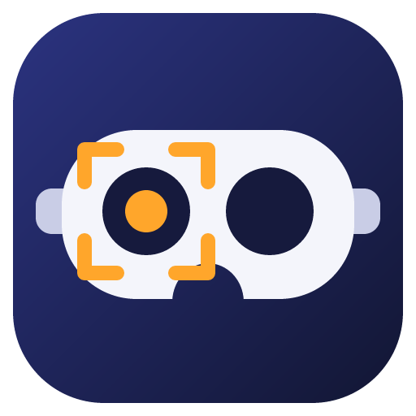

# UnMeta Screenshare

**Mirror your Meta Quest's view and sound to your computer over Wi-Fi, without the Meta casting app.**

[Français](README.fr.md)

UnMeta Screenshare is a small terminal app for Windows, macOS and Linux. A step-by-step wizard sets up wireless ADB on the headset once; after that, one key starts streaming. It is built on [scrcpy](https://github.com/Genymobile/scrcpy) and [adb](https://developer.android.com/tools/adb), and needs no Meta account sign-in on the PC, no cloud and no casting service. That makes it a good fit for a hardened headset where Meta's casting features are turned off.

> This project is not affiliated with, endorsed by or sponsored by Meta Platforms, Inc. "Meta Quest" is a trademark of Meta Platforms, Inc.

## Features

- **Guided setup**: plug in, allow USB debugging, enable Wi-Fi ADB, read the IP, unplug, connect. Each step explains what to do and moves on by itself when it detects the headset.
- **One-key streaming**: press Space on the home screen. If the Wi-Fi drops, the app reconnects and restarts the stream by itself (for up to a minute).
- **Live display settings**: move or resize the crop with the arrow keys, rotate with + / -, change the audio, frame rate, bitrate, window mode. scrcpy restarts in about a second to show each change.
- **Audio**: off, PC only, or headset + PC at the same time.
- **Saved headsets**: several headsets, each with its address and display settings.
- **English and French** interface (follows the system language; press `L` to switch).

## How it works

```
Quest  ──(adb over Wi-Fi, port 5555)──>  your computer  ──>  scrcpy window + sound
```

The Quest renders a side-by-side image for both eyes. The default *Meta Quest 3* preset crops one eye out of it and straightens its tilt, giving a normal flat picture. The crop is scaled to the image size the headset reports, so there is nothing to measure by hand.

## Requirements

- A Meta Quest with **developer mode** on (see [First-time setup](#first-time-setup)).
- A **USB-C data cable**, for the first setup and after each headset reboot.
- The headset and the computer on the **same Wi-Fi network**.
- **scrcpy 3.0+** and **adb**. The Windows installer includes both.

Tested on a Meta Quest 3. Other models should work with the *Full frame* preset and some tuning: please [share your settings](#contributing).

## Install

### Windows

Download `UnMeta-Screenshare-Setup-x.y.z.exe` from the [Releases](https://github.com/SeifB13/unmeta-screenshare/releases) page and run it. scrcpy and adb are included. A portable `.zip` is also available.

The executable is not code-signed yet, so Windows SmartScreen may warn you: click *More info → Run anyway*.

### macOS

```bash
curl -fsSL https://raw.githubusercontent.com/SeifB13/unmeta-screenshare/main/scripts/install.sh | bash
```

The script installs scrcpy and adb with Homebrew if missing, then the app with pipx. Or do it by hand:

```bash
brew install scrcpy pipx
brew install --cask android-platform-tools
pipx install git+https://github.com/SeifB13/unmeta-screenshare
```

### Linux

```bash
curl -fsSL https://raw.githubusercontent.com/SeifB13/unmeta-screenshare/main/scripts/install.sh | bash
```

Distribution packages of scrcpy are often older than 3.0. If so, install a recent build following the [scrcpy Linux guide](https://github.com/Genymobile/scrcpy/blob/master/doc/linux.md). USB access may need udev rules (`android-sdk-platform-tools-common` on Debian/Ubuntu, `android-udev-rules` on Arch).

Then run:

```bash
unmeta
```

## First-time setup

1. **Enable developer mode** in the Meta Horizon phone app: *Devices → your headset → Headset settings → Developer mode*. It requires a free [Meta developer account](https://developers.meta.com/horizon/). Restart the headset.
2. Start UnMeta Screenshare. The wizard opens on first launch (or press `W`):
   1. Checks that adb and scrcpy are available.
   2. Asks you to plug the headset in with the USB-C cable.
   3. Waits while you accept **Allow USB debugging** inside the headset (tick *Always allow*).
   4. Enables Wi-Fi ADB and reads the headset's IP address.
   5. Asks you to unplug the cable.
   6. Connects over Wi-Fi and saves the headset.

Tip: reserve the headset's IP address in your router (DHCP reservation) so it never changes.

## Everyday use

Turn the headset on, start the app, press **Space**.

**After a headset reboot**, Wi-Fi ADB is turned off by the system. Press `W`, plug the cable in and go through the steps again (about 30 seconds).

| Key | Home screen |
|---|---|
| Space | Start / stop streaming |
| C | Connect |
| D | Display settings |
| W | Setup wizard |
| L | Switch language |
| I | Copy a diagnostic report |
| ? | Help |
| Q | Quit |

## Display settings

Press `D`. A map shows the headset's whole image with the crop rectangle on it (red where the crop goes past the edge). Focus the *Live adjust* panel, then:

| Key | Action |
|---|---|
| ← ↑ ↓ → | Move the crop (10 px) |
| Ctrl + arrows | Move the crop faster (50 px) |
| Shift + arrows | Resize the crop |
| V or F6 | Full frame on/off: see the whole image to find the eye |
| + / - | Rotate (1°) |
| Enter or F5 | Apply |
| Ctrl+R | Reset to the preset |

While streaming, changes apply by themselves after a short pause. scrcpy cannot change these options on the fly, so the app restarts it (about 1-2 s); the Wi-Fi connection stays up. Streaming is windowed by default so the app stays reachable: press Alt+F in the scrcpy window to toggle fullscreen, or turn on *Fullscreen* in the settings (the stream stays windowed while you tune). The generated scrcpy command is shown at the bottom, handy for bug reports.

Settings are saved per headset in `config.json` (`unmeta --print-config-path` shows where).

## Troubleshooting

To report a problem, press `I` on the home screen: a report (versions, headset, settings, recent log, no serial number) is copied to the clipboard, ready to paste.

- **Cannot reach the headset**: it is asleep, on another network, or it rebooted (redo the setup with the cable).
- **No debugging prompt**: unplug and replug the cable; check developer mode; try another cable.
- **Picture off-center or tilted**: in *Display settings*, press V to see the whole image, place the rectangle on the eye, press V again. Crop and angle depend on each other.
- **No sound**: try the *PC only* audio mode.
- **Choppy video**: lower the bitrate or the max FPS, or move closer to the router.

## Security

Wi-Fi ADB gives full debugging access to the headset from your local network. Connections still need the RSA key you approved in the headset, but keep it in mind on shared networks. It turns off when the headset reboots, or right away with `adb usb` while the cable is plugged in. You can revoke approved computers in the headset's developer settings.

## Contributing

Bug reports and presets for other headsets are welcome: open an issue with your headset model, scrcpy version and the command shown in *Display settings*.

Development setup:

```bash
python -m venv .venv
.venv/bin/pip install -e ".[dev]"     # Windows: .venv\Scripts\pip
.venv/bin/pytest
.venv/bin/ruff check . && .venv/bin/ruff format --check .
python -m unmeta
```

To build the Windows installer locally:

```bash
pip install -e ".[build]"
python packaging/windows/fetch_scrcpy.py
pyinstaller packaging/windows/unmeta.spec --noconfirm
iscc /DAppVersion=0.1.0 packaging/windows/installer.iss   # Inno Setup 6
```

## Credits and license

UnMeta Screenshare is released under the [MIT License](LICENSE).

It drives [scrcpy](https://github.com/Genymobile/scrcpy) by Genymobile and Romain Vimont (Apache License 2.0), which the Windows build bundles together with adb from the Android SDK Platform-Tools. See [THIRD_PARTY_NOTICES.md](packaging/windows/THIRD_PARTY_NOTICES.md).
